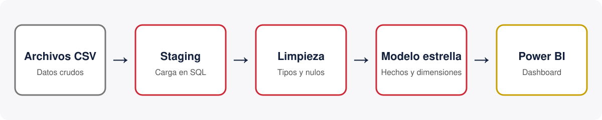
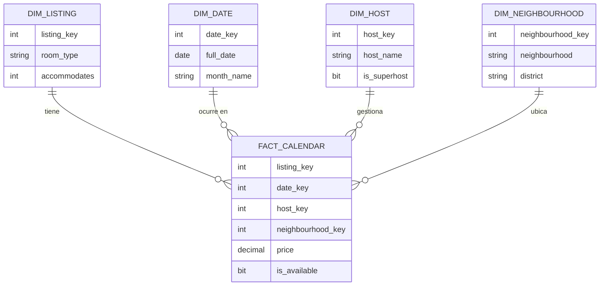
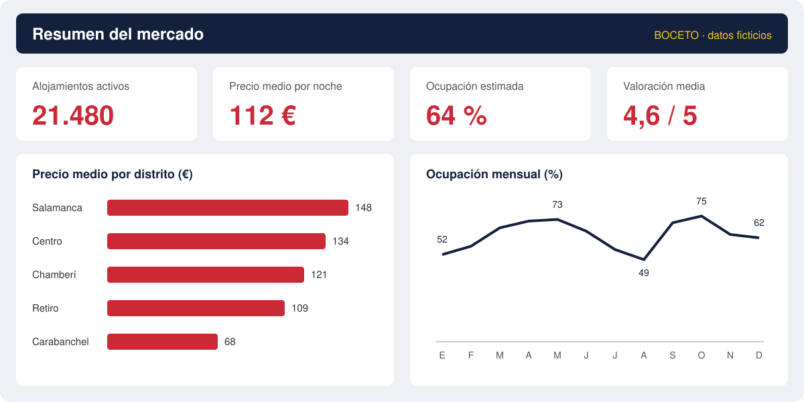

<p align="center">
  
</p>

<h1 align="center">🏠 Airbnb Madrid · Análisis de Datos</h1>

<p align="center">
  
  
  
</p>

> 🎓 Proyecto educativo de análisis de datos de principio a fin: **arranca en SQL y termina en Power BI**.
> No está afiliado a Airbnb.

---

## 📑 Índice

- [🎯 Objetivo](#-objetivo)
- [❓ Preguntas de negocio](#-preguntas-de-negocio)
- [🗂️ Datos](#️-datos)
- [🔄 Flujo de trabajo](#-flujo-de-trabajo)
- [⭐ Modelo de datos](#-modelo-de-datos)
- [📊 Dashboard](#-dashboard)
- [📁 Estructura prevista](#-estructura-prevista)
- [🗺️ Hoja de ruta](#️-hoja-de-ruta)

---

## 🎯 Objetivo

Una gestora ficticia de alojamientos turísticos, **Llave Maestra**, quiere invertir en Madrid.
Antes de comprar o alquilar nada, necesita saber **dónde**, **qué tipo de alojamiento** y **a qué precio** publicar.

## ❓ Preguntas de negocio

| # | Pregunta | Métrica clave |
|---|----------|---------------|
| 1 | 📍 ¿Qué distritos tienen los precios más altos? | Precio medio por noche |
| 2 | 📅 ¿Cómo cambia la demanda a lo largo del año? | Ocupación estimada mensual |
| 3 | 🛏️ ¿Qué tipo de alojamiento genera más ingresos? | Ingreso estimado por anuncio |
| 4 | ⭐ ¿Influyen las valoraciones en el precio? | Puntuación media frente a precio |
| 5 | 🧑‍💼 ¿Cuánto pesan los anfitriones profesionales? | % de anuncios de anfitriones con varias propiedades |

## 🗂️ Datos

La fuente prevista es [Inside Airbnb](https://insideairbnb.com/get-the-data/), que publica datos abiertos por ciudad.

| Archivo | Contenido |
|---------|-----------|
| 🏘️ `listings.csv` | Alojamientos: ubicación, tipo, capacidad, precio y anfitrión |
| 🗓️ `calendar.csv` | Disponibilidad por fecha |
| 💬 `reviews.csv` | Reseñas de los huéspedes |
| 🗺️ `neighbourhoods.csv` | Barrios y distritos |

> ⚠️ La ocupación y los ingresos son **estimaciones**: una noche no disponible puede estar reservada o bloqueada por el anfitrión.

## 🔄 Flujo de trabajo

<p align="center">
  
</p>

1. 📥 **Ingesta:** carga de los CSV en tablas *staging* de SQL Server.
2. 🧹 **Limpieza:** conversión de tipos, tratamiento de nulos, duplicados y valores atípicos.
3. 🔍 **Exploración:** consultas con *joins*, CTEs y funciones de ventana.
4. 🏗️ **Modelado:** vistas organizadas en un modelo estrella.
5. 📊 **Visualización:** medidas DAX y dashboard interactivo en Power BI.

Ejemplo del tipo de consulta que usará el proyecto:

```sql
-- Ranking de distritos por precio medio
SELECT
    district,
    COUNT(*)                                   AS total_listings,
    AVG(price)                                 AS avg_price,
    RANK() OVER (ORDER BY AVG(price) DESC)     AS price_rank
FROM clean.listings
WHERE price > 0
GROUP BY district;
```

## ⭐ Modelo de datos



## 📊 Dashboard

<p align="center">
  
</p>

> 🖌️ La imagen es un **boceto con cifras inventadas**, no un resultado del análisis.

| Página | Qué mostrará |
|--------|--------------|
| 🌍 Resumen | Indicadores principales del mercado |
| 🗺️ Mapa | Precios y oferta por barrio |
| 📈 Temporada | Evolución de precio y ocupación |
| 💰 Rentabilidad | Comparador de zonas y tipos de alojamiento |

## 📁 Estructura prevista

```text
Airbnb/
├── 📂 assets/        # Imágenes del README
├── 📂 data/          # CSV originales (no versionados)
├── 📂 sql/
│   ├── 01_staging.sql
│   ├── 02_limpieza.sql
│   ├── 03_exploracion.sql
│   └── 04_modelo.sql
├── 📂 powerbi/       # Archivo .pbix
└── 📄 README.md
```

## 🗺️ Hoja de ruta

- [x] 📝 Definir el proyecto
- [ ] 📥 Descargar los datos y cargarlos en SQL Server
- [ ] 🧹 Limpiar y validar
- [ ] 🔍 Analizar con SQL
- [ ] ⭐ Construir el modelo estrella
- [ ] 📊 Crear el dashboard en Power BI
- [ ] 💡 Publicar conclusiones y recomendaciones

---

<p align="center">Hecho con ☕, SQL y Power BI</p>
